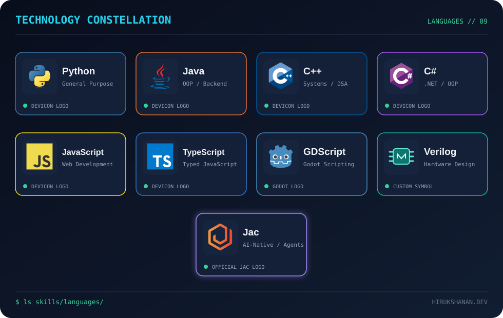
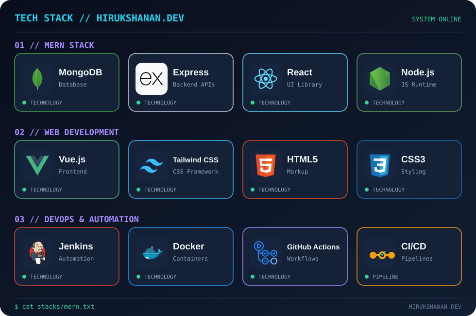
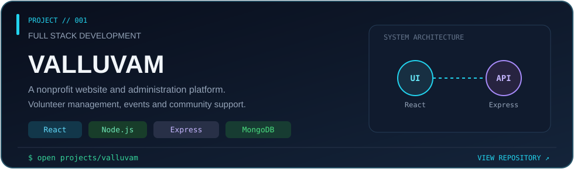
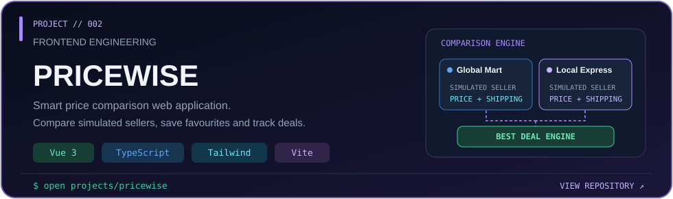
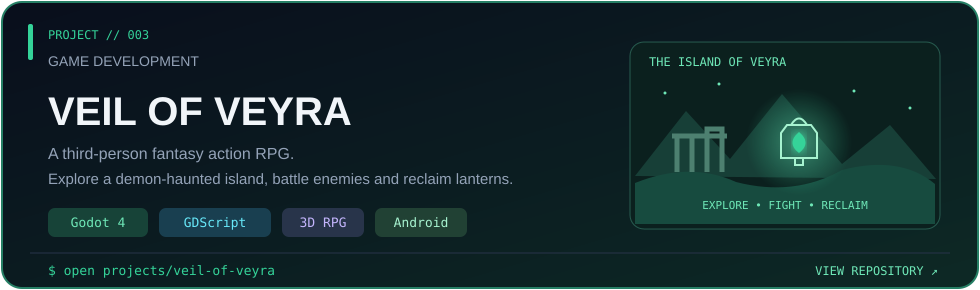

 

  

### 💻 Full Stack • 🤖 AI/ML • 🛡️ Cybersecurity • 🎮 Game Development

**Computer Engineering Undergraduate | University of Ruhuna, Sri Lanka**

 

 

<h2 align="center">⚡ TECHNOLOGY CONSTELLATION</h2>

  <i>Technologies I work with and explore</i>

  
<b>💻 Programming Languages</b>

   

  

    
  

 

  
<b>🌐 Web Development, MERN Stack & DevOps</b>

   

  

    
  

 

<!-- FEATURED PROJECTS -->

 

<h2 align="center">🚀 FEATURED PROJECTS</h2>

  <i>Real projects. Real code. Built with curiosity.</i>

 

<!-- PROJECT 01: VALLUVAM -->

 

<!-- PROJECT 02: PRICEWISE -->

 

<!-- PROJECT 03: VEIL OF VEYRA -->

 

  <a href="https://github.com/Hirukshanan?tab=repositories">
    <b>Explore All My Repositories</b>
  </a>

 

  
    Explore these projects through my interactive terminal
  

  <a href="https://hirukshanan.github.io/Hirukshanan/">
    <code>$ cd projects &amp;&amp; ls</code>
  </a>

 

 

<h2 align="center">🔥 CODING STREAK</h2>

  

 

<!-- CONNECT WITH ME -->

 

<h2 align="center">📡 ESTABLISH CONNECTION</h2>

  <code>$ ./connect --with hirukshanan</code>

  

  

  

  SECURE CONNECTION • HIRUKSHANAN.DEV

 
